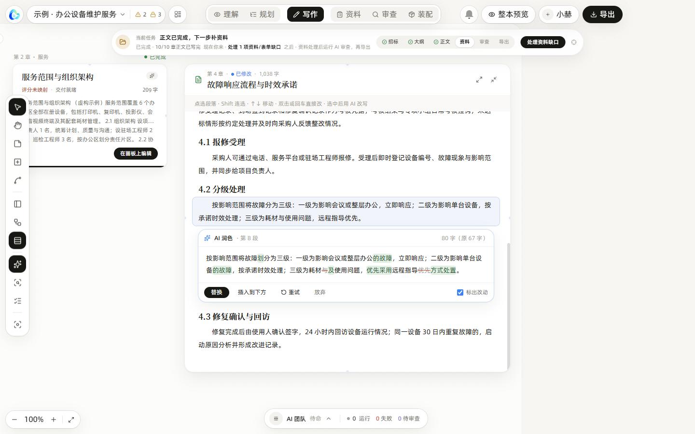

# BidCore

**BidCore 投标 AI 工作台**，由长沙芠硕科技有限公司（芠硕科技）开发和运营。

导入招标文件，AI 逐条读懂要求，生成大纲和正文；写好的标书可以交给“标书审查”逐段找问题，在画布上逐条改完，再按原文件格式导出 Word。

**当前版本：Windows 正式版 1.0.6。** [下载与发行说明](https://github.com/haozhentech/BidCore-Desktop/releases/latest) · [官网下载页](https://bidcore.cn/download.html)。支持 Windows 10 / 11 x64；安装包暂未做代码签名，请核对发行页的 SHA256SUMS.txt。官网 bidcore.cn（湘ICP备2026026376号-3），bidcore.wenshuotech.cn 是备用网址。

## 能做什么

- **读标**：导入招标文件（Word、PDF、扫描件），整理资格要求、评分项、废标条款和投标文件组成。
- **写标**：按招标要求生成大纲和正文，接入公司档案、资质和业绩材料；在画布的文档卡里选中段落让 AI 修改，先看标出的改动再替换。
- **审标**：写好的标书（含旧版 .doc）逐段审查，和招标文件、公司档案核对；导出批注版 Word、审查意见单，或导入画布逐条修改后按原文件格式导出。
- **导出**：Word / PDF，多包项目可以按采购包分别导出。

## 计费与数据

- 软件限时免费下载。写作、识图、配图和标书审查都从 BidCore 密钥的积分里按用量扣，价格见官网[价格页](https://bidcore.cn/pricing.html)；私有化部署按项目单独报价。
- 项目和资料保存在你的电脑上。使用 AI 时，完成任务所需的内容会经 BidCore 的服务器转发给模型服务商处理；服务器只记录调用的密钥、时间、模型和用量，用于计费，不保存你发送的内容。详见[数据与模型服务](docs/data-and-ai.md)。
- 生成和审查的结果都需要人工复核；报价、资质、签章和最终版式由投标人确认。

## 文档

[使用指南](docs/getting-started.md) · [数据与模型服务](docs/data-and-ai.md) · [常见问题](docs/faq.md) · [更新记录](CHANGELOG.md) · [使用条款](docs/beta-terms.md)

## 关于本仓库

这是 BidCore 的公开发行与反馈仓库：发布安装包、发行说明和产品文档，收集问题反馈。核心软件源码为私有，本仓库不授予源码的开源许可；第三方组件遵循各自的许可证。

使用条款以官网的[用户协议](https://bidcore.cn/terms.html)和[隐私政策](https://bidcore.cn/privacy.html)为准。

发现问题请到 [Issues](https://github.com/haozhentech/BidCore-Desktop/issues/new/choose) 反馈，只提交脱敏的步骤、截图或虚构样例，不要上传密钥、客户原件或未公开的投标材料；安全问题请用 Security 里的私密报告入口。

© 2026 长沙芠硕科技有限公司 · [BidCore 官网](https://bidcore.cn/) · [芠硕科技](https://wenshuotech.cn/)
